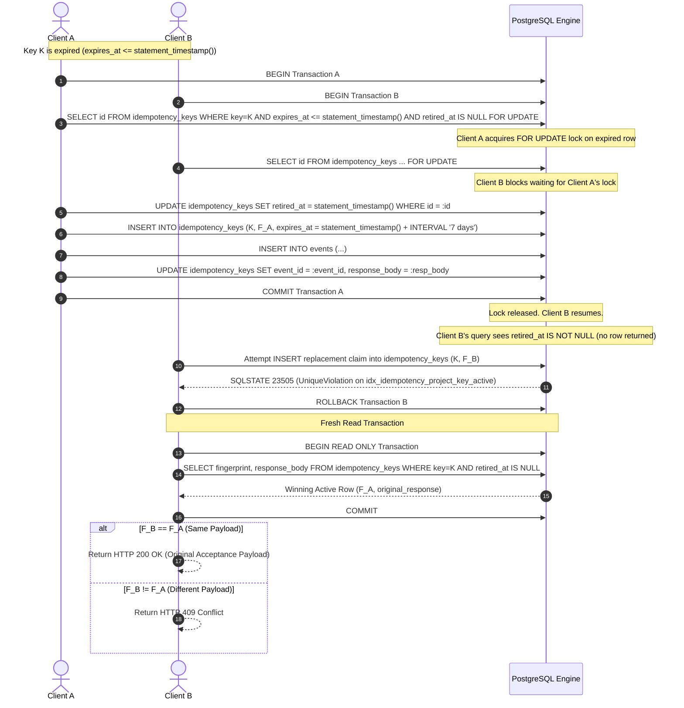

# HookRelay M1 Gate 1 — Technical Specification
# Document 02: Idempotency Transaction and Concurrency Contract

- **Document Version:** 1.3.0
- **Milestone:** M1 — Event Ingestion & Idempotency Engine
- **Gate:** 1 — Technical Contract & Architecture Specification
- **Status:** Complete — Revised per Anna Independent Review & Odin Final Requirements
- **Traceability:** HR-ARCH-001, HR-IDEM-001, HR-IDEM-002, HR-CANON-005

---

## 1. Objective & Authority Baseline

This contract establishes the transactional and relational semantics for event ingestion and idempotency key lifecycle in HookRelay.

### 1.1. HTTP Status-Code Authority Table
The ingestion response mapping is governed strictly by the following authoritative baseline:

| HTTP Status | Meaning | Authority |
|---|---|---|
| **200 OK** | Existing key, identical payload fingerprint (replayed original event acceptance) | **HR-IDEM-002** (Approved) |
| **202 Accepted** | New event accepted and queued for processing | **HR-IDEM-002** (Approved) |
| **400 Bad Request** | Malformed JSON, non-object root, duplicate keys, unsafe integers, or canonicalization rejection | **HR-IDEM-002** (Approved) |
| **409 Conflict** | Existing active key reused with different payload fingerprint | **HR-IDEM-002** (Approved) |
| **413 Payload Too Large** | Payload exceeds 1 MiB streaming limit | Proposed transport mapping; pending explicit founder approval |
| **415 Unsupported Media Type** | Unsupported media type or unsupported compression | Unresolved authority question; pending explicit founder approval |

---

## 2. Relational Schema & Structural Requirements

### 2.1. Normative PostgreSQL Requirements (Mandatory Conditions)

The persistence engine must enforce the following relational requirements:

1. **Active Partial Unique Index (`HR-IDEM-002`):**
   ```sql
   CREATE UNIQUE INDEX idx_idempotency_project_key_active
   ON idempotency_keys (project_id, idempotency_key)
   WHERE retired_at IS NULL;
   ```
   *Requirement:* Enforces key uniqueness only across active (non-retired) rows.
2. **Deferred Foreign Key (`HR-ARCH-001`):**
   - The foreign key constraint from `idempotency_keys.event_id` to `events.id` must be defined as `DEFERRABLE INITIALLY DEFERRED`.
   - *Requirement:* Allows the idempotency claim to be inserted before the associated Event within the same transaction. The transaction must never commit an orphaned idempotency claim (enforced by the deferred constraint check at commit).
3. **Storage Approach:**
   - *Proposed Technical Recommendation:* PostgreSQL `BYTEA` storage in `events.raw_payload_bytes` is proposed for payloads up to 1 MiB in v1, pending explicit Founder approval. External object storage remains outside the current v1 scope.

### 2.2. Illustrative Relational DDL

> *Note: The following DDL is provided for structural illustration. Implementation migrations remain strictly prohibited in Gate 1.*

```sql
CREATE TABLE idempotency_keys (
    id UUID PRIMARY KEY DEFAULT gen_random_uuid(),
    project_id UUID NOT NULL,
    idempotency_key VARCHAR(255) NOT NULL,
    fingerprint VARCHAR(128) NOT NULL,
    event_id UUID NULL,
    response_status_code INTEGER NULL,
    response_headers JSONB NULL,
    response_body JSONB NULL,
    created_at TIMESTAMPTZ NOT NULL DEFAULT statement_timestamp(),
    expires_at TIMESTAMPTZ NOT NULL,
    retired_at TIMESTAMPTZ NULL,

    -- Deferred Foreign Key (HR-ARCH-001)
    CONSTRAINT fk_idempotency_keys_event_id
        FOREIGN KEY (event_id)
        REFERENCES events(id)
        ON DELETE RESTRICT
        DEFERRABLE INITIALLY DEFERRED
);

CREATE TABLE events (
    id UUID PRIMARY KEY DEFAULT gen_random_uuid(),
    project_id UUID NOT NULL,
    idempotency_key_id UUID NOT NULL,
    event_type VARCHAR(100) NOT NULL,
    raw_payload_bytes BYTEA NOT NULL,
    payload_hash VARCHAR(128) NOT NULL,
    created_at TIMESTAMPTZ NOT NULL DEFAULT statement_timestamp(),

    CONSTRAINT fk_events_idempotency_key
        FOREIGN KEY (idempotency_key_id)
        REFERENCES idempotency_keys(id)
        ON DELETE RESTRICT
);
```

---

## 3. Expiry Boundary & Lock Timeout Specifications

### 3.1. Normative Expiry Boundary Definitions
To ensure mathematical precision across all queries, application checks, and tests, the key lifecycle boundary is strictly defined against PostgreSQL `statement_timestamp()`:

- **Active Key:** `expires_at > statement_timestamp()`
- **Expired Key:** `expires_at <= statement_timestamp()`

*Critical Boundary Invariant:* A key is **never permitted to remain active at its exact expiration time**. If `expires_at == statement_timestamp()`, the key is logically expired.

### 3.2. Lock Timeout Specification
- **Normative Status:** **`TBD — determined through Stage B capacity and load testing.`**
- Gate 1 does not establish a final lock timeout.
- *Stage B Proposals:*
  - Anna suggested **500ms** as a possible starting point for testing.
  - Odin previously discussed **2 seconds** as a potential threshold.
  - Both values remain proposed benchmarks for capacity testing. Language suggesting zero wait or a fixed approved timeout is explicitly prohibited.

---

## 4. Concurrent Expired-Key Replacement & Concurrency Recovery

### 4.1. Complete PostgreSQL Concurrency Workflow
When two or more concurrent requests compete to replace an expired idempotency key, PostgreSQL transaction serialization coordinates the replacement through the following mandatory 7-step sequence:



### 4.2. Step-by-Step Replacement Protocol
1. **Acquire `FOR UPDATE`:** Competing transactions attempt:
   ```sql
   SELECT id FROM idempotency_keys
   WHERE project_id = :project_id
     AND idempotency_key = :idempotency_key
     AND expires_at <= statement_timestamp()
     AND retired_at IS NULL
   FOR UPDATE;
   ```
2. **Retire Expired Record:** The winning transaction marks the expired row as retired:
   ```sql
   UPDATE idempotency_keys
   SET retired_at = statement_timestamp()
   WHERE id = :expired_id;
   ```
3. **Insert Replacement Claim:** Winner creates the replacement claim:
   ```sql
   INSERT INTO idempotency_keys (
       id, project_id, idempotency_key, fingerprint, expires_at, created_at
   ) VALUES (
       :id, :project_id, :idempotency_key, :fingerprint, statement_timestamp() + INTERVAL '7 days', statement_timestamp()
   );
   ```
4. **Partial Unique Index Safeguard:** The index `idx_idempotency_project_key_active` serves as the absolute physical integrity safeguard.
5. **Rollback on Unique Violation:** Any concurrent request that fails the insert due to SQLSTATE `23505` (`UniqueViolation`) must **immediately issue `ROLLBACK`**.
6. **Fresh Transaction Re-Read:** The losing request opens a clean, fresh read transaction:
   ```sql
   BEGIN TRANSACTION ISOLATION LEVEL READ COMMITTED READ ONLY;
   SELECT fingerprint, response_status_code, response_body
   FROM idempotency_keys
   WHERE project_id = :project_id
     AND idempotency_key = :idempotency_key
     AND retired_at IS NULL;
   COMMIT;
   ```
7. **Fingerprint Evaluation & Response:**
   - **Matching Fingerprint:** Returns **HTTP 200 OK** containing the winning event's acceptance response body.
   - **Different Fingerprint:** Returns **HTTP 409 Conflict** (`IDEMPOTENCY_KEY_FINGERPRINT_MISMATCH`).
   - **Integrity Guarantee:** Two requests competing to replace the same expired key **must never create duplicate Events**.

---

## 5. Duplicate Response Definition & Incomplete Record Protection

### 5.1. Exact Response Body for HTTP 200 OK (`HR-IDEM-002`)
When returning `HTTP 200 OK` on a duplicate request, the response body is **strictly identical to the original event acceptance payload** stored at initial ingestion:

```json
{
  "event_id": "018f3a5b-7c2a-7e1d-84f9-2b8109d76543",
  "status": "accepted",
  "idempotency_key": "user_provided_key",
  "fingerprint": "jcs-rfc8785-v1:e3b0c44298fc1c149afbf4c8996fb92427ae41e4649b934ca495991b7852b855",
  "created_at": "2026-11-21T02:00:00Z"
}
```
- **Response Header:** Must include `Idempotent-Replay: true`.
- **Strict Invariant:** **Never use HTTP 202 for a duplicate request.**

### 5.2. Incomplete Record Handling (`response_body IS NULL`)
1. In HookRelay, key claim, event creation, and response body population occur in the **same atomic SQL transaction before `COMMIT`**.
2. Under PostgreSQL MVCC Read Committed isolation, uncommitted rows are invisible to other transactions; aborted attempts are discarded completely on rollback.
3. Therefore, incomplete records **cannot become externally visible as committed acceptance**.
4. If a reading transaction ever encounters `response_body IS NULL` during an edge-case concurrency race:
   - The reader **must never return HTTP 202** or assume accepted ingestion.
   - The reader waits within the bounded lock timeout for the writer transaction to conclude.
   - If the writer aborts, the row is discarded and the reader claims the key cleanly as a fresh event (HTTP 202).
   - If the writer commits, `response_body` is populated and the reader returns **HTTP 200 OK**.

---

## 6. Retention and Physical Cleanup Policy

1. **Retention Range:** Configurable between **1 and 60 days**; default is **7 days**.
2. **Immediate Logical Reuse:** Once `retired_at` is set, immediate key reuse succeeds without waiting for background vacuum or physical deletion.
3. **Separate Physical Purge:** An asynchronous janitor process periodically removes rows retired longer than the audit retention threshold:
   ```sql
   DELETE FROM idempotency_keys
   WHERE retired_at < statement_timestamp() - INTERVAL '30 days';
   ```
   Physical deletion is completely decoupled from real-time ingestion.
