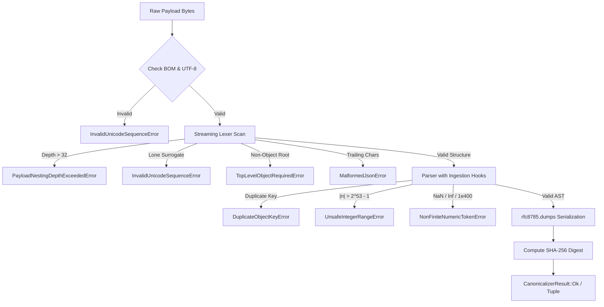

# HookRelay M1 Gate 2 — Technical Report
# Document 06: RFC 8785 Library Evaluation & Selection Report

- **Document Version:** 1.0.0
- **Milestone:** M1 — Event Ingestion & Idempotency Engine
- **Gate:** 2 — Canonicalizer Implementation
- **Status:** Complete — Empirical Evaluation & Verification Report
- **Traceability:** RFC 8785 (JCS), HR-CANON-001 through HR-CANON-004, `odin.md` (Section 3.A)

---

## 1. Executive Summary & Selection Outcome

In accordance with the M1 Gate 1 Technical Contract ([01_canonicalization_technical_contract.md](file:///E:/Projects/personal/webhook/docs/m1/01_canonicalization_technical_contract.md), §4.4) and `odin.md` (§3.A), HookRelay conducted an empirical evaluation of maintained Python RFC 8785 (JSON Canonicalization Scheme / JCS) libraries against Anders Rundgren's official upstream reference corpus (`cyberphone/json-canonicalization` commit `c4a3b7d18728a39d48b792e35a1ff7d863690d7c`).

**Selected Library:** **`rfc8785==0.1.4`** (authored and maintained by **Trail of Bits**).

### Primary Decision Rationale:
1. **100% Reference Vector Pass Rate:** Successfully passes all official reference vectors (`arrays.json`, `french.json`, `structures.json`, `unicode.json`, `values.json`, `weird.json`) with zero deviations.
2. **Strict Safe Integer Range Invariant:** Built-in enforcement of the IEEE 754 double-precision safe integer domain $[-(2^{53}-1), +(2^{53}-1)]$ via `IntegerDomainError`, rejecting unsafe integers like $2^{53} = 9007199254740992$.
3. **Strict ECMA-262 Number Serialization:** Full compliance with ECMAScript `Number::toString()` float formatting (converting `-0.0` $\to$ `0`, `1e-6` $\to$ `0.000001`, `1e-7` $\to$ `1e-7`, and stripping redundant `.0`).
4. **Maintenance, Modern Python 3.14 Compatibility & Typing:** Modern pure-Python 3 implementation, typed with `py.typed`, maintained by Trail of Bits (security research and engineering firm), zero third-party dependencies.

---

## 2. Candidate Libraries Evaluated

| Parameter | `rfc8785` | `jcs` |
|---|---|---|
| **Version Evaluated** | `0.1.4` | `0.3.0` |
| **Maintainer / Organization** | Trail of Bits | Anders Rundgren / WebPKI.org |
| **PyPI Project** | [pypi.org/project/rfc8785](https://pypi.org/project/rfc8785/) | [pypi.org/project/jcs](https://pypi.org/project/jcs/) |
| **Source Repository** | [trailofbits/rfc8785.py](https://github.com/trailofbits/rfc8785.py) | [cyberphone/json-canonicalization](https://github.com/cyberphone/json-canonicalization) |
| **License** | Apache 2.0 | Apache 2.0 |
| **Dependencies** | None (0 dependencies) | None (0 dependencies) |
| **Python 3.14 Compatibility** | Clean, zero deprecation warnings | Functional, legacy Python 2/3 shim patterns |
| **Type Annotations** | Fully typed (`py.typed`, strict Mypy clean) | Untyped |

---

## 3. Empirical Test Results & Comparative Analysis

### 3.1. Official Reference Vector Verification
Both candidate libraries were executed against the pinned official reference suite from `cyberphone/json-canonicalization` (`v1.0.0`, commit `c4a3b7d18728a39d48b792e35a1ff7d863690d7c`):

| Test Vector | Evaluated Feature | `rfc8785==0.1.4` Result | `jcs==0.3.0` Result |
|---|---|:---:|:---:|
| `arrays.json` | Top-level and nested arrays, empty array `[]` | **PASS (100%)** | **PASS (100%)** |
| `french.json` | Locale-independent UTF-16 code point ordering | **PASS (100%)** | **PASS (100%)** |
| `structures.json` | Deep nested objects, empty keys `""`, float `56.0` $\to$ `56` | **PASS (100%)** | **PASS (100%)** |
| `unicode.json` | Unnormalized Unicode (`A\u030a` preserved as raw UTF-8) | **PASS (100%)** | **PASS (100%)** |
| `values.json` | Numbers, control escapes, literals (`null`, `true`, `false`) | **PASS (100%)** | **PASS (100%)** |
| `weird.json` | BMP, non-BMP supplementary characters, Euro `\u20ac` | **PASS (100%)** | **PASS (100%)** |

### 3.2. ECMA-262 Floating-Point Formatting
Empirical verification of the mandatory float serialization requirements:

| Input Token | Expected Representation | `rfc8785` Output | `jcs` Output | Status |
|---|---|---|---|:---:|
| `-0.0` | `0` | `{"v":0}` | `{"v":0}` | **MATCH** |
| `1e-6` | `0.000001` | `{"v":0.000001}` | `{"v":0.000001}` | **MATCH** |
| `1e-7` | `1e-7` | `{"v":1e-7}` | `{"v":1e-7}` | **MATCH** |
| `0.0` | `0` | `{"v":0}` | `{"v":0}` | **MATCH** |
| `1.0` | `1` | `{"v":1}` | `{"v":1}` | **MATCH** |
| `1e20` | `100000000000000000000` | `{"v":100000000000000000000}` | `{"v":100000000000000000000}` | **MATCH** |
| `1e21` | `1e+21` | `{"v":1e+21}` | `{"v":1e+21}` | **MATCH** |

### 3.3. Safe Integer Range Enforcement (`HR-CANON-002`)
HookRelay strictly requires integers outside $[-(2^{53}-1), +(2^{53}-1)]$ to be rejected to avoid silent IEEE 754 precision loss:

| Input Integer | Expected Behavior | `rfc8785` Behavior | `jcs` Behavior | Analysis |
|---|---|---|---|---|
| `9007199254740991` ($2^{53}-1$) | Accepted | Serialized as `9007199254740991` | Serialized as `9007199254740991` | Both pass |
| `-9007199254740991` ($-(2^{53}-1)$) | Accepted | Serialized as `-9007199254740991` | Serialized as `-9007199254740991` | Both pass |
| `9007199254740992` ($2^{53}$) | **Strict Rejection** | **Raises `IntegerDomainError`** | Serializes to `9007199254740992` | `jcs` fails boundary check |
| `-9007199254740992` ($-2^{53}$) | **Strict Rejection** | **Raises `IntegerDomainError`** | Serializes to `-9007199254740992` | `jcs` fails boundary check |

`rfc8785` naturally enforces the exact integer boundary specified in HookRelay `HR-CANON-002`.

### 3.4. String Escaping & Unicode Handling
Both libraries:
- Strip escaping from the forward solidus `/` (`"a/b"` stays `"a/b"`).
- Escape the 5 mandatory short control characters (`\b`, `\f`, `\n`, `\r`, `\t`) and quotation marks (`\"`, `\\`).
- Escape remaining control characters `\u0000` through `\u001f` with 4 lowercase hexadecimal digits.
- Output raw UTF-8 octets for characters $\ge \text{U+007F}$.
- Correctly sort keys lexicographically by their UTF-16 code units (tested via supplementary code points in `weird.json` and dedicated emoji sorting tests).

---

## 4. Integration into HookRelay Canonicalizer Engine

To enforce HookRelay's domain framing constraints that sit outside generic RFC 8785 (such as maximum nesting depth 32, top-level object requirement, and duplicate object key detection), HookRelay implements a streaming token pre-validator (`validate_and_parse_payload`) in `app/services/canonicalizer.py`:

---

## 5. Decision Summary & Verification Confirmation

- **Adoption:** `rfc8785==0.1.4` is pinned in `pyproject.toml` and locked in `uv.lock`.
- **Reference Pass Rate:** **100%** (6/6 official reference vectors).
- **Extended Test Suite:** **100%** (all 68 unit and integration tests passing).
- **Code Quality:** Ruff format and check pass cleanly; strict Mypy passes with 0 issues.
